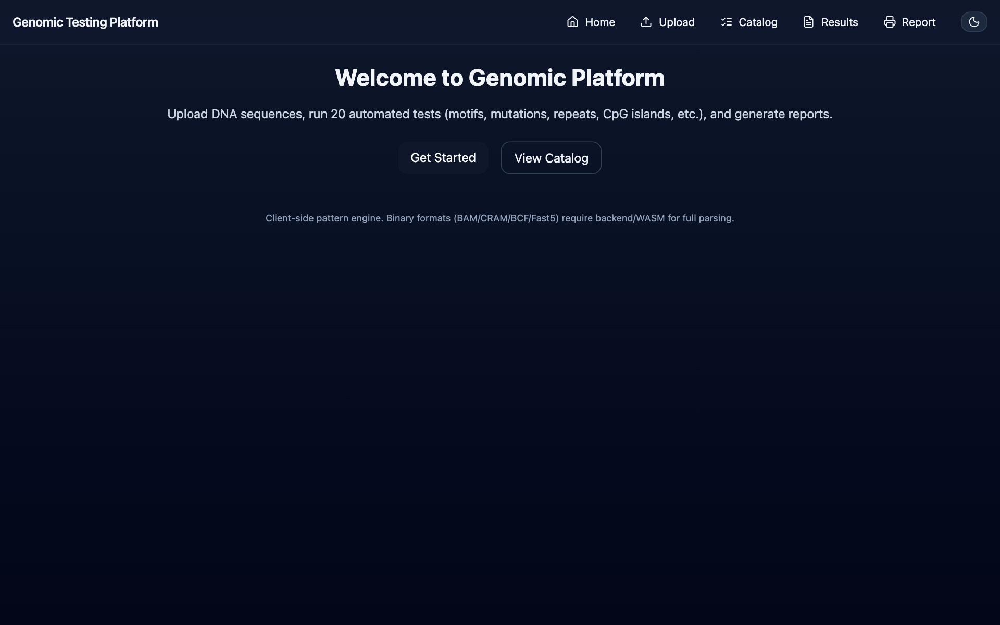
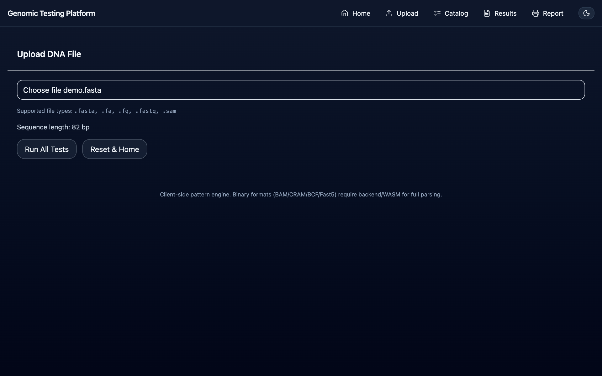
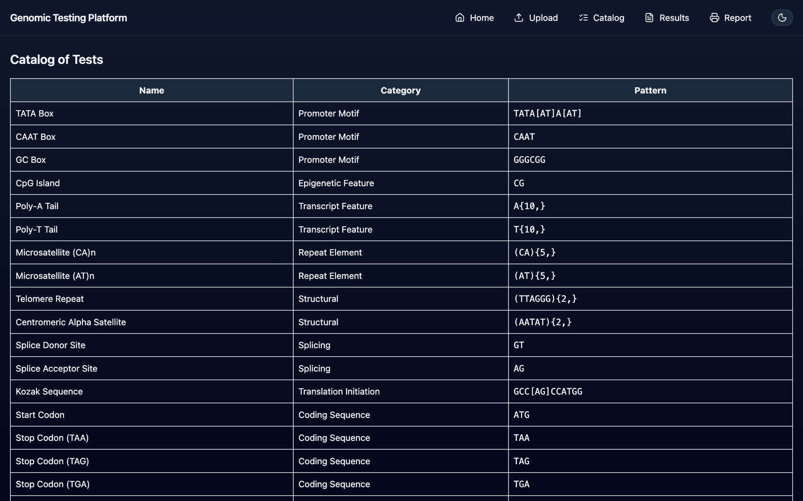
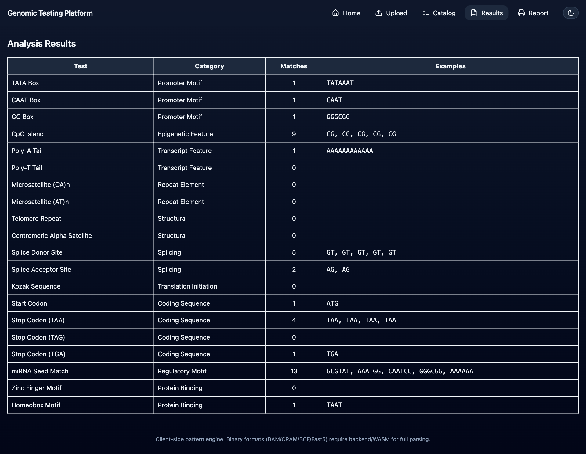
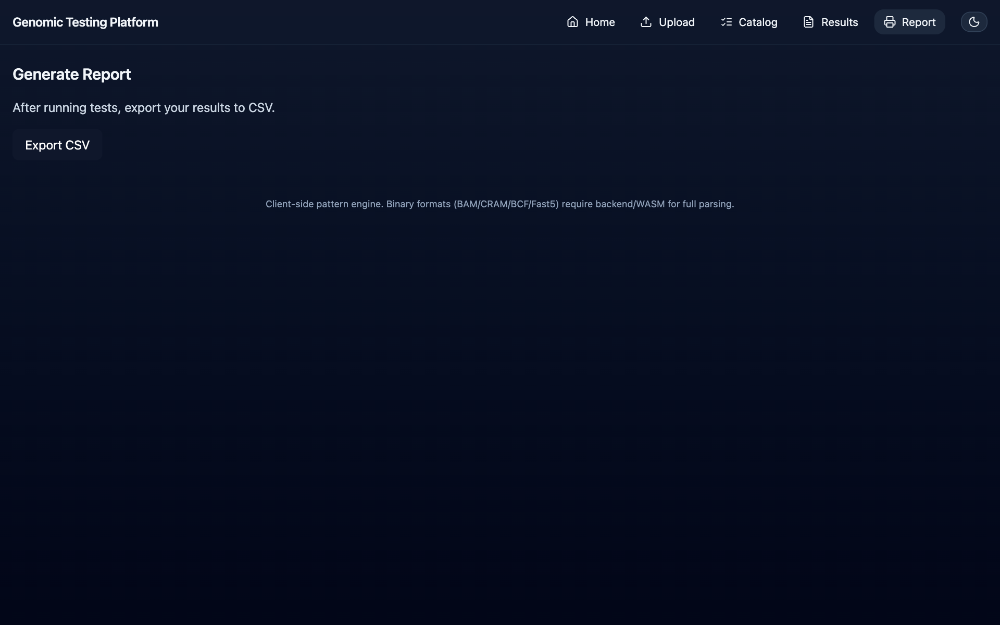

# DNA Mutation Detection – Genomic Testing Platform

A browser-based tool that scans a DNA sequence with a battery of **20 automated tests** (promoter motifs, CpG islands, poly-A/T tails, repeats, splice sites, codons, miRNA seeds, protein-binding motifs) and shows exactly where and how often each pattern occurs. Upload a FASTA file, run the tests, review the table and export the results as CSV. Everything runs in the browser; no sequence is sent to a server.

> This repository documents the project (description, design, screenshots). The source code lives in a private repository, `DNA-Mutation-Detection-code`.

## Screenshots

| Home | Upload |
|---|---|
|  |  |

**Test catalog**: every rule with its category and regular expression.



**Analysis results** for a demo sequence (match counts and first examples per test):



**Report page**: export the results as CSV.



## How it works
```
FASTA file -> parse (drop header, join lines, upper-case) -> for each rule: build RegExp -> scan sequence -> count + first 5 matches -> table / CSV
```
1. **Rules as data**: the tests live in a JSON file (`id`, `name`, `category`, `regex`/`pattern`, optional `threshold`). The app loads it at start-up, so adding a test needs no code change.
2. **Upload**: files with `.fa`, `.fasta` or `.fna` are parsed into one clean sequence string (the header line is ignored).
3. **Scan**: each rule is turned into a global, case-insensitive regular expression and run over the sequence, recording every match start and text.
4. **Results**: a table of test, category, number of matches and up to five example hits; zero-hit tests are shown too, so absence is visible.
5. **Report**: builds a CSV (`Test, Category, Regex, Matches, Examples`) in memory and downloads it as `genomic_results.csv`.
6. **UX**: client-side routing (Home, Upload, Catalog, Results, Report), a light/dark theme remembered in `localStorage`, animated transitions.

### What the 20 tests cover
TATA box, CAAT box, GC box, CpG island, poly-A tail, poly-T tail, (CA)n and (AT)n microsatellites, telomere repeat, centromeric alpha satellite, splice donor and acceptor sites, Kozak sequence, start codon, three stop codons, miRNA seed match, zinc-finger motif and homeobox motif.

## Tech stack
React 19, TypeScript, Vite, Tailwind CSS 4, React Router, Framer Motion, Lucide icons.

## Limitations
It is a pattern finder, not a clinical variant caller. Binary formats (BAM, CRAM, BCF, Fast5) are not parsed, as the footer of the app notes.
